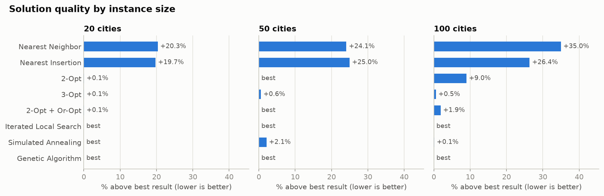
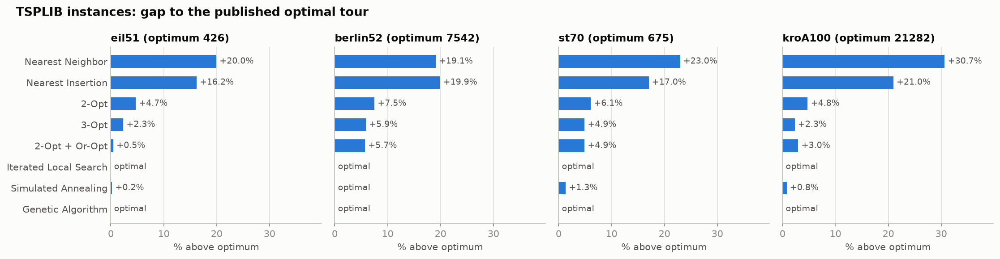
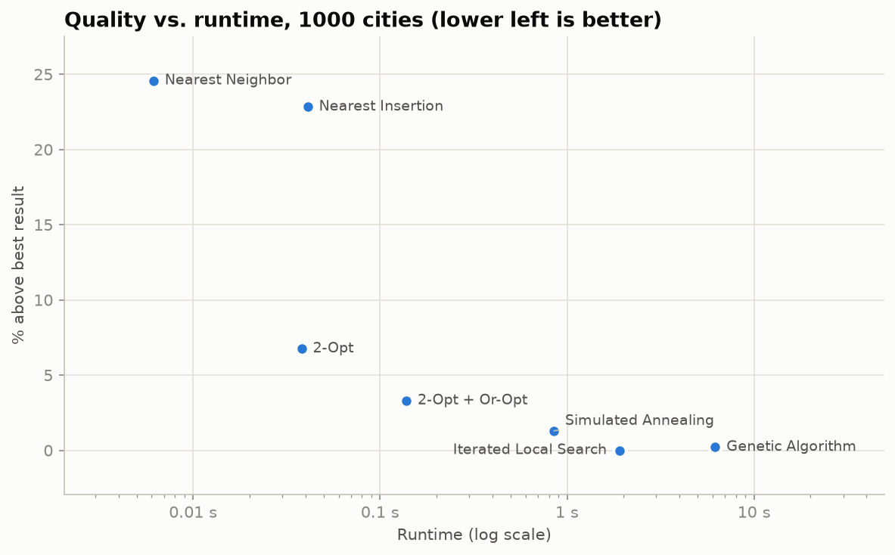
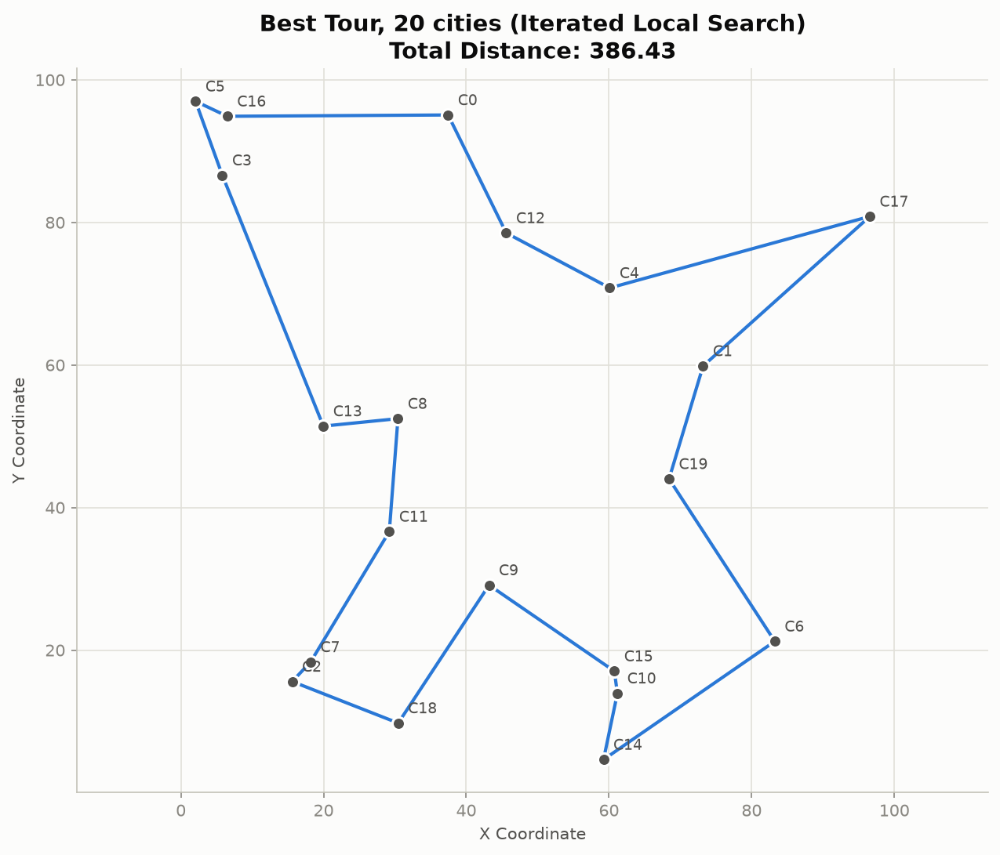
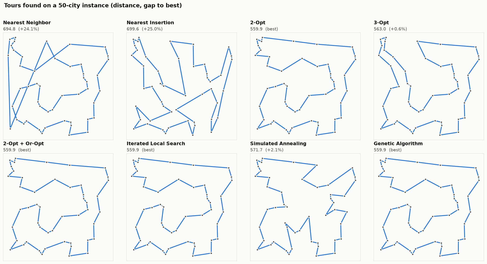

# Traveling Salesman Problem Solver

[](https://www.python.org/downloads/)
[](LICENSE)
[](#algorithms)
[](https://github.com/efkopru/traveling-salesman/actions/workflows/tests.yml)

A Python implementation of exact, constructive, local-search and metaheuristic algorithms for the Traveling Salesman Problem (TSP), with TSPLIB support, a command-line interface and reproducible benchmarks.

## Algorithms

| Algorithm | Type | Time Complexity | Strengths |
|-----------|------|----------------|-----------|
| **Brute Force** | Exact | O(n!) | Guaranteed optimum; feasible for n ≤ 10 |
| **Held-Karp** | Exact (dynamic programming) | O(n²·2ⁿ) | Guaranteed optimum up to 20 cities (≈1 s) |
| **Nearest Neighbor** | Greedy | O(n²) | Very fast, simple |
| **Nearest Insertion** | Constructive | O(n²) | Fast, similar quality to Nearest Neighbor |
| **2-Opt** | Local Search | O(n²) per pass, usually far less | Large improvement in milliseconds; 2000 cities in 0.1 s |
| **3-Opt** | Local Search | O(n³) per pass | True 3-opt local optimum; practical up to about 150 cities |
| **Or-Opt** | Local Search | O(n·k) per pass | Moves segments of 1–3 cities |
| **2-Opt + Or-Opt** | Local Search | — | 2-opt, then both until neither improves; never worse than 2-Opt |
| **Iterated Local Search** | Metaheuristic | O(iterations) | Local double-bridge kicks repaired by 2-opt and Or-opt; best quality per second |
| **Simulated Annealing** | Metaheuristic | O(iterations) | Escapes local optima; temperatures calibrated on its own moves |
| **Genetic Algorithm** | Memetic (GA + local search) | O(gen · pop · local search) | Matches Iterated Local Search up to about 1000 cities, at several times the runtime |

How the local search stays fast:
- Every move is evaluated in O(1) from the distance matrix, without recomputing the tour.
- 2-Opt scans each city's partners in order of distance and stops as soon as no improving move is possible. Only the few nearest partners are sorted up front; the rest of a list is sorted if a scan ever reaches it.
- "Don't-look bits" skip cities whose surroundings have not changed; a final sweep over all cities confirms that no improving move is left, so the default 2-Opt and 2-Opt + Or-Opt results are true local optima.
- The tour is an array with a position index, and a move reverses whichever side of the tour is shorter.
- Iterated Local Search kicks a short stretch of the tour and repairs only around it, so beyond a few hundred cities the cost of a kick no longer grows with the instance.

Improvements are judged relative to the largest distance of the instance, so the same cities in metres or in kilometres give the same tour, whatever the magnitude of the coordinates.

## Performance Results

### Random instances

Random uniform instances in a 100×100 square, `generate_random_cities(n)` with the default seed and `TSPSolver(..., seed=42)`. Percentages are relative to the best result in each column (bold). For 20 cities the best result, 386.43, is the proven optimum (Held-Karp). Times are the fastest of 3 runs and vary by machine.

| Algorithm | 20 cities | 50 cities | 100 cities | Time at 100 cities (s) |
|-----------|-----------|-----------|------------|------------------------|
| Nearest Neighbor | 465.04 (+20.3%) | 694.76 (+24.1%) | 1006.40 (+35.0%) | 0.0001 |
| Nearest Insertion | 462.66 (+19.7%) | 699.63 (+25.0%) | 942.29 (+26.4%) | 0.0008 |
| 2-Opt | 386.63 (+0.1%) | **559.86** | 812.63 (+9.0%) | 0.0010 |
| 3-Opt | 386.63 (+0.1%) | 563.02 (+0.6%) | 749.82 (+0.5%) | 0.17 |
| 2-Opt + Or-Opt | 386.63 (+0.1%) | **559.86** | 759.67 (+1.9%) | 0.0040 |
| Iterated Local Search | **386.43** | **559.86** | **745.73** | 0.19 |
| Simulated Annealing | **386.43** | 571.66 (+2.1%) | 746.57 (+0.1%) | 0.11 |
| Genetic Algorithm | **386.43** | **559.86** | **745.73** | 0.62 |



### TSPLIB instances (gap to the published optimum)

Four classic instances from [TSPLIB](http://comopt.ifi.uni-heidelberg.de/software/TSPLIB95/) are bundled in [`data/tsplib`](data/tsplib). Distances use TSPLIB's rounding convention, so lengths are directly comparable with the published optima. Bold means optimal.

| Algorithm | eil51 (426) | berlin52 (7542) | st70 (675) | kroA100 (21282) |
|-----------|-----------|-----------|-----------|-----------|
| Nearest Neighbor | 511 (+20.0%) | 8980 (+19.1%) | 830 (+23.0%) | 27807 (+30.7%) |
| Nearest Insertion | 495 (+16.2%) | 9043 (+19.9%) | 790 (+17.0%) | 25742 (+21.0%) |
| 2-Opt | 446 (+4.7%) | 8108 (+7.5%) | 716 (+6.1%) | 22294 (+4.8%) |
| 3-Opt | 436 (+2.3%) | 7986 (+5.9%) | 708 (+4.9%) | 21775 (+2.3%) |
| 2-Opt + Or-Opt | 428 (+0.5%) | 7974 (+5.7%) | 708 (+4.9%) | 21915 (+3.0%) |
| Iterated Local Search | **426** | **7542** | **675** | **21282** |
| Simulated Annealing | 427 (+0.2%) | **7542** | 684 (+1.3%) | 21450 (+0.8%) |
| Genetic Algorithm | **426** | **7542** | **675** | **21282** |



The last three algorithms are randomized, so one seed says little about them. Over 20 seeds (0–19), the number of runs that reach the optimum and the mean gap to it:

| Algorithm | eil51 | berlin52 | st70 | kroA100 |
|-----------|-----------|-----------|-----------|-----------|
| Iterated Local Search | 17/20 (+0.04%) | 20/20 (+0.00%) | 20/20 (+0.00%) | 20/20 (+0.00%) |
| Simulated Annealing | 1/20 (+0.62%) | 17/20 (+0.42%) | 5/20 (+0.88%) | 0/20 (+0.51%) |
| Genetic Algorithm | 19/20 (+0.01%) | 20/20 (+0.00%) | 20/20 (+0.00%) | 20/20 (+0.00%) |

### Larger instances

Tour length and runtime on random instances (same generator, one run each). Bold is the best result for that size. 3-Opt is left out: its O(n³) passes take minutes here.

| Algorithm | 200 cities | 500 cities | 1000 cities | 2000 cities |
|-----------|-----------|-----------|-----------|-----------|
| Nearest Neighbor | 1303.4 (1.0 ms) | 2002.4 (2.9 ms) | 2839.4 (6.1 ms) | 4026.2 (16 ms) |
| Nearest Insertion | 1236.1 (6.0 ms) | 2052.5 (18 ms) | 2799.7 (41 ms) | 4073.4 (0.11 s) |
| 2-Opt | 1094.3 (3.9 ms) | 1743.3 (14 ms) | 2433.2 (38 ms) | 3448.1 (99 ms) |
| 2-Opt + Or-Opt | 1078.2 (14 ms) | 1710.4 (45 ms) | 2354.6 (0.14 s) | 3362.3 (0.36 s) |
| Iterated Local Search | 1045.1 (0.50 s) | **1640.2** (0.81 s) | **2279.3** (1.9 s) | **3255.8** (3.9 s) |
| Simulated Annealing | 1069.3 (0.13 s) | 1652.8 (0.37 s) | 2308.9 (0.85 s) | 3324.3 (1.7 s) |
| Genetic Algorithm | **1038.4** (1.2 s) | 1642.7 (3.5 s) | 2284.2 (6.2 s) | 3286.9 (13 s) |



The solver keeps the whole distance matrix in memory, about 40 bytes per pair of cities: 40 MB for 1000 cities, 1 GB for 5000. That puts the practical limit at a few thousand cities.

## Installation

```
pip install -e .            # core solver (NumPy only)
pip install -e ".[all]"     # + matplotlib (plots) and pandas (benchmarks)
pip install -e ".[dev]"     # + pytest, for development
```

## Quick Start

```python
from tsp_solver import TSPSolver, generate_random_cities

# Generate random cities
cities = generate_random_cities(50)

# Create solver (seed makes the randomized algorithms reproducible)
solver = TSPSolver(cities, seed=42)

# Fast high-quality solution
tour, distance = solver.two_opt()
print(f"2-Opt distance: {distance:.2f}")

# Best quality per second
tour, distance = solver.iterated_local_search()
print(f"Iterated local search distance: {distance:.2f}")

# Visualize the tour (needs matplotlib)
solver.visualize_tour(tour, "Optimized Tour")
```

## Command Line

Installing the package adds a `tsp-solver` command (also available as `python -m tsp_solver`).

```
tsp-solver solve data/tsplib/berlin52.tsp                 # TSPLIB file
tsp-solver solve cities.csv -a 2-opt -a genetic_algorithm  # CSV: x,y[,name] per row
tsp-solver solve --random 200 --seed 1 --plot tour.png --tour-out tour.txt
tsp-solver solve --random 2000 --time-limit 10             # keep improving for 10 seconds
tsp-solver demo                                            # the 20-city example below
```

Repeat `-a` to compare algorithms. The default algorithm is `iterated_local_search`. Choices: `brute_force`, `held_karp`, `nearest_neighbor`, `nearest_insertion`, `2-opt`, `3-opt`, `2-opt+or-opt`, `iterated_local_search`, `simulated_annealing`, `genetic_algorithm`.

- **CSV files** may have a header row; the optional third column names the cities. Fields may be separated by commas, semicolons, tabs or spaces (with semicolons or tabs, decimal commas are read too). Files are read as UTF-8, or as Windows-1252 if they are not valid UTF-8.
- **TSPLIB files**: for the standard instances the published optimum is known, and the gap to it is printed.
- **`--seed`** makes the randomized algorithms reproducible; `--random N` without `--seed` uses seed 42 for both the cities and the algorithms.
- **`--time-limit SECONDS`** lets `iterated_local_search` run for that long instead of its default number of kicks. The result then depends on the speed of the machine as well as on the seed.
- **`--plot`** labels the cities only up to 50 of them; **`--tour-out`** writes UTF-8.

```
$ tsp-solver solve data/tsplib/berlin52.tsp -a 2-opt -a genetic_algorithm --seed 42
Instance: berlin52 (52 cities, EUC_2D), optimum 7542
Algorithm                     Distance       Gap    Time (s)
2-opt                          8108.00     7.50%      0.0006
genetic_algorithm              7542.00     0.00%      0.3059

Best: genetic_algorithm, distance 7542.00
Tour: 18 -> 31 -> 22 -> 1 -> 49 -> 32 -> 45 -> 19 -> ... -> 18
```

## Example Output

Running `python -m tsp_solver demo`:

```
============================================================
TRAVELING SALESMAN PROBLEM - 20 Cities
============================================================

Algorithm Comparison:
------------------------------------------------------------
Algorithm              Distance        Time (s)
------------------------------------------------------------
nearest_neighbor       465.04          0.0000
nearest_insertion      462.66          0.0001
2-opt                  386.63          0.0002
3-opt                  386.63          0.0006
2-opt+or-opt           386.63          0.0003
iterated_local_search  386.43          0.0553
simulated_annealing    386.43          0.0692
genetic_algorithm      386.43          0.1376
held_karp              386.43          0.7402
------------------------------------------------------------

Best Solution: iterated_local_search
Tour: C0 -> C16 -> C5 -> C3 -> C13 -> ...
Total Distance: 386.43

============================================================
ADDITIONAL ANALYSIS
============================================================

Small Instance (8 cities) - Exact vs Heuristic:
Exact Solution: 277.23
Heuristic Solution: 277.23
Gap: 0.00%
```

Best tour for the 20-city instance, drawn with `solver.visualize_tour`:



The tour each algorithm finds on the 50-city instance. Crossing edges are a visible sign of a non-optimal tour; 2-Opt removes all of them.



### Regenerating the figures

All images and the results tables above come from one script:

```
python scripts/generate_figures.py
```

It takes about two minutes. Distances are deterministic; times depend on the machine.

## Usage Examples

### Basic Usage

```python
import numpy as np
from tsp_solver import TSPSolver

# Define city coordinates
cities = np.array([
    [60, 200], [180, 200], [80, 180], [140, 180],
    [20, 160], [100, 160], [200, 160], [140, 140]
])

solver = TSPSolver(cities)

# Fast approximation
tour_nn, dist_nn = solver.nearest_neighbor()

# Improve an existing tour
tour_2opt, dist_2opt = solver.two_opt(tour_nn)
tour_ls, dist_ls = solver.local_search(tour_2opt)    # 2-Opt + Or-Opt

# Optimal solution for small instances
tour_exact, dist_exact = solver.held_karp()           # up to 20 cities
```

### TSPLIB files

```python
from tsp_solver import TSPSolver, load_tsplib

solver = TSPSolver.from_tsplib("data/tsplib/kroA100.tsp", seed=42)
tour, distance = solver.iterated_local_search()
print(distance, load_tsplib("data/tsplib/kroA100.tsp")["optimum"])   # 21282.0 21282
```

`EUC_2D`, `CEIL_2D` and `ATT` distance types are supported. Pass `distance="EUC_2D"` (or another TSPLIB convention) to `TSPSolver` to use the rounded distances directly.

`load_tsplib` returns the published optimum for 74 standard instances with these distance types (`TSPLIB_OPTIMA`, e.g. `a280`, `pr1002`, `d1291`), so your own copies of those files are compared with the optimum as well.

### Algorithm Comparison

```python
results = solver.compare_algorithms([
    'nearest_neighbor',
    '2-opt',
    '2-opt+or-opt',
    'iterated_local_search',
    'simulated_annealing',
    'genetic_algorithm',
])

for algo, data in results.items():
    print(f"{algo}: Distance={data['distance']:.2f}, Time={data['time']:.4f}s")
```

- **Errors:** unknown algorithm names raise `ValueError`.
- **Size limits:** exact algorithms are skipped above their limit (brute force 10 cities, Held-Karp 20).
- **Seeding:** with a seed, every algorithm starts from the same random stream, so its result does not depend on which algorithms ran before it.
- **Options:** pass keyword arguments for individual algorithms with `options`, e.g. `solver.compare_algorithms(['2-opt', 'iterated_local_search'], options={'iterated_local_search': {'time_limit': 5}})`.

### Benchmarks with pandas

```python
import glob
from tsp_solver import TSPBenchmark

df = TSPBenchmark.run_tsplib_benchmark(sorted(glob.glob("data/tsplib/*.tsp")),
                                       ["2-opt", "iterated_local_search"], seed=42)
print(df[["Instance", "Algorithm", "Distance", "Optimum", "Gap (%)"]])
```

### Tuning

```python
solver.two_opt(neighbors=10)                    # only the 10 nearest cities as partners: faster on large instances
solver.iterated_local_search(iterations=20000)  # more kicks, better tours (default: max(1000, 2 x cities))
solver.iterated_local_search(time_limit=30)     # or keep kicking for 30 seconds
solver.simulated_annealing(max_iterations=2000000)        # default: max(100000, 500 x cities)
solver.genetic_algorithm(population_size=50, generations=100)   # default: 30 tours, 40 generations
solver.held_karp(max_cities=22)                 # memory grows as n * 2^n
```

### Saving a plot without displaying it

```python
solver.visualize_tour(tour, "Tour", save_path="tour.png", show=False)
```

City names are drawn for up to 50 cities; pass `labels=True` or `labels=False` to decide yourself.

## Project Structure

```
src/tsp_solver/solver.py      TSPSolver: all algorithms, distances, plotting
src/tsp_solver/tsplib.py      TSPLIB reader and known optima
src/tsp_solver/benchmark.py   Benchmark helpers (pandas)
src/tsp_solver/cli.py         Command-line interface
src/tsp_solver/demo.py        The example comparison (tsp-solver demo)
data/tsplib/                  Bundled TSPLIB instances
tests/                        pytest suite
scripts/generate_figures.py   Regenerates images/ and the results tables
images/                       README figures
```

## Running Tests

```
pip install -e ".[dev]"
pytest
```

## Algorithm Selection Guide

### When to Use Each Algorithm

**Held-Karp / Brute Force**
- Guaranteed optimum: Held-Karp up to 20 cities, brute force up to 10

**Nearest Neighbor / Nearest Insertion**
- Need instant results
- Starting tour for local search

**2-Opt / 2-Opt + Or-Opt**
- Good tours in milliseconds; scale to thousands of cities
- Real-time applications

**Iterated Local Search**
- Default choice: a fraction of a second up to a few hundred cities, seconds for thousands
- Optimal on all four TSPLIB instances above, in 77 of 80 runs over 20 seeds
- Give it more kicks or a time limit when the tour matters more than the wait

**Genetic Algorithm**
- As good as Iterated Local Search up to about 1000 cities (optimal in 79 of the 80 TSPLIB runs), at 2–5× the runtime

**Simulated Annealing**
- The simplest of the three: usually 0.5–1% above the optimum on the TSPLIB instances and 1–2% behind Iterated Local Search on large ones, in less time

**3-Opt**
- Included for comparison: it returns a true 3-opt local optimum, but 2-Opt + Or-Opt gives similar quality much faster (O(n³) per pass limits 3-Opt to about 150 cities)


## Real-World Applications

This TSP solver can be applied to various optimization problems:

- **Logistics and Delivery**: Optimize delivery routes to minimize fuel costs
- **Manufacturing**: Minimize tool path length in CNC machining
- **Circuit Board Design**: Optimize component placement and routing
- **DNA Sequencing**: Find optimal sequence assembly order
- **Tourism Planning**: Create efficient sightseeing routes


## Performance Tips

1. **For instant results with good quality**: Use 2-Opt (it starts from Nearest Neighbor)
2. **For the best quality per second**: Use Iterated Local Search; raise `iterations` or set `time_limit` for more
3. **For large instances (1000+ cities)**: Iterated Local Search still works (about 2 s for 1000 cities, 4 s for 2000); for milliseconds, use `two_opt(neighbors=10)` or `local_search()`
4. **For reproducible results**: Pass `seed=` to `TSPSolver`
5. **For guaranteed optimal (≤20 cities)**: Use Held-Karp

## Roadmap

Suggested next improvements (contributions welcome):

- **Lin–Kernighan-style moves**: variable-depth k-opt moves (as in LKH) are the next step in tour quality beyond 2-Opt + Or-Opt, and would make each kick of Iterated Local Search count for more.
- **Larger TSPLIB benchmarks**: bundle instances with 1,000+ cities (e.g. `pr1002`, `d1291`; their optima are already in `TSPLIB_OPTIMA`) next to the random instances above.
- **Distances that are not Euclidean**: accept a distance matrix (road distances, travel times) and TSPLIB's `EXPLICIT` and `GEO` instances.
- **Beyond a few thousand cities**: build the neighbor lists from a spatial index and compute distances on demand instead of storing the full matrix.
- **Compiled inner loops**: the local search, simulated annealing and the genetic algorithm are pure-Python loops; Numba or Cython could make them roughly 10–50× faster.
- **PyPI release**: the package already installs with `pip install -e .`; publishing it (under a name still free on PyPI) would allow `pip install` without cloning the repository.

## References

1. Applegate, D. L., Bixby, R. E., Chvatal, V., & Cook, W. J. (2006). *The Traveling Salesman Problem: A Computational Study*
2. Helsgaun, K. (2000). "An effective implementation of the Lin-Kernighan traveling salesman heuristic"
3. Johnson, D. S., & McGeoch, L. A. (1997). "The traveling salesman problem: A case study in local optimization"
4. Held, M., & Karp, R. M. (1962). "A dynamic programming approach to sequencing problems"
5. Reinelt, G. (1991). "TSPLIB — A Traveling Salesman Problem Library"
6. Martin, O., Otto, S. W., & Felten, E. W. (1991). "Large-step Markov chains for the traveling salesman problem"
7. Bentley, J. J. (1992). "Fast algorithms for geometric traveling salesman problems"

## License

MIT License - See [LICENSE](LICENSE) file for details

## Author

GitHub: [@efkopru](https://github.com/efkopru)
